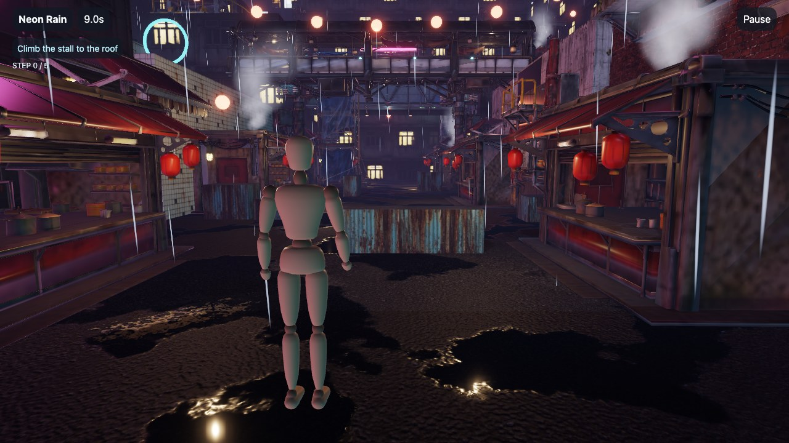

# Neon Rain

Neon Rain is a market street at night, in the rain, and the roofs above it. It is mode 3 (`CITY_MODE`). The level is in `logic/src/city.rs` and its parts are in `logic/src/kit.rs`.



## Layout

The street is 12 m wide and runs north from the start. Three buildings stand on each side, and the building `north` closes the street. `north` carries the pink sign, which is the goal. The player sees the sign from the first step.

Higher buildings stand behind every roof of the route. They are the walls of the level. Twelve far towers stand in the fog. A train viaduct crosses behind the start.

## Route

The route crosses the street three times. Each crossing is higher than the last.

| Step | The HUD asks | Move | Height of the feet |
|---|---|---|---|
| 1 | Climb the stall to the roof | Climb a crate, catch the roof of the stall, catch the roof `west-low` | 0 to 4.6 m |
| 2 | Cross the covered walkway | Mantle onto the deck and run east | 5.6 m |
| 3 | Take the fire escape up | Walk up the steps, climb the top landing | 5.6 to 8.4 m |
| 4 | Run the roof of the skybridge | Mantle onto the bridge, run west, mantle onto `west-high` | 9.2 to 10.0 m |
| 5 | Jump the alley to the pink sign | Sprint, jump a 2 m alley to a roof 1.4 m higher | 11.4 m |

`logic/tests/city.rs` checks each rise against the limit of the move that makes it. One test runs the full route with the stick and the Jump button only.

## How the player finds the way

No paint shows the route. A light marks the end of each step.

| Step | Light |
|---|---|
| The crate and the stall | Warm lanterns and a red bulb above the crate |
| The walkway | Three warm lamps inside it |
| The fire escape | A red lamp |
| The skybridge | Cyan bulbs along its roof |
| The goal | The pink sign, and its pink light on the street |

One cyan ring stands at the end of the current step. The HUD shows the step as text.

## Performance

| Item | Value |
|---|---|
| Lights | 35 point lights and the moon |
| Triangles sent in one frame | About 600,000, which counts both detail levels of each model |
| Rain | 1,300 streaks at most, in a 34 m box that follows the body |
| Cloud | 60 puffs |
| Steam | 5 vents, 18 puffs each |

Each model has a `-far` copy with a fifth of the triangles and a 256 pixel image. `ModelLod` draws the copy from 42 m. All the boxes of the district (street, buildings, crates, towers, signs) are one model with one mesh for each surface.

The level was run in the web host on a Mac only. It was not run on a phone.

## Change the level

1. Change the tables in `logic/src/city.rs` (`BUILDINGS`, `ROUTE`, `SIGNS`, `BINS`, `TOWERS`) or the placements in `route`, `market` and `roofs`.
2. Write the district model again:

   ```sh
   EXPORT=1 cargo test --manifest-path .shells/Cargo.toml -p exact-beat-em-up-logic --test city district
   ```

3. Run `bun exact.mjs test-rust`.

To look at a place, send the body there and set the camera:

```sh
bun exact.mjs agent web --size 1280x720 "tap city" "clock +9000" \
  "type world message goto 12 8.4 -23 -90" "type world message camera 5 1.6 1.4" \
  "clock +500" "screenshot skybridge.png"
```

## Not done

- The elevator, the crane, the scaffold and the zipline anchors are scenery. The body cannot ride or climb them.
- The fire escape's second flight is a 1.5 m climb, not steps.
- No sound.
- No frame time was measured. `perf` in the headless web host gives counts only.
